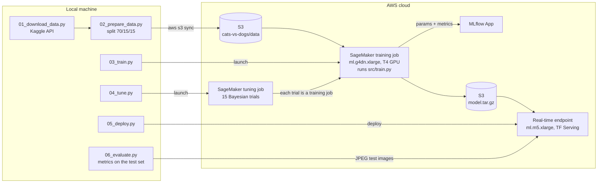

# SageMaker MLOps — End-to-End ML Workflow on AWS

A transfer-learning image classifier (cats vs. dogs) built as a **production-style
machine-learning pipeline on Amazon SageMaker**, rather than a single notebook.
The model is trained in the cloud on a GPU instance, every run is tracked in MLflow,
and the full lifecycle — data → S3 → managed training → experiment tracking →
model artifact → (deployment next) — is driven by reproducible scripts.

**Stack:** AWS SageMaker · MLflow (SageMaker serverless MLflow) · TensorFlow 2.14 (Keras) ·
VGG16 transfer learning · Amazon S3 · IAM · Python

---

## Why this project

Most coursework trains models locally in Colab/Jupyter. This project re-implements
a transfer-learning classifier the way it would run in a company: training is
dispatched to the cloud, data and model artifacts live in S3, experiments are tracked
in MLflow, access is governed by an IAM execution role, and every step is a versioned,
repeatable script. The dataset is deliberately simple and clean so the focus stays on
the AWS / MLOps workflow.

## Pipeline



- **`config.py`** — central config: region, IAM execution-role ARN, MLflow App ARN,
  S3 prefixes.
- **`01_download_data.py`** — pull the Kaggle competition data into `data/`.
- **`02_prepare_data.py`** — sort images into `cats/` and `dogs/` by filename, take
  10,000 per class, and make a **stratified 70/15/15 train/val/test split**
  (reproducible, seed=42). `test` is held out and never touched during training.
- **`03_train.py`** — *launcher* that runs locally and submits a SageMaker training
  job (chooses the instance, framework container, hyperparameters, S3 I/O, and passes
  the MLflow tracking URI and experiment name as environment variables).
- **`04_tune.py`** — *launcher* for a SageMaker **hyperparameter tuning job**: reuses the
  same training script, searches learning rate, hidden units and dropout, and returns
  immediately (`wait=False`) while the trials run in the cloud.
- **`src/train.py`** — the *training script* that actually runs inside the cloud
  container. An **end-to-end model**: raw pixels → VGG16 preprocessing → frozen
  VGG16 convolutional base → flatten → feature-wise standardisation → classifier
  head → sigmoid probability. The standardisation statistics are computed on
  the **training set only** (no leakage from validation/test) and stored inside the
  model, so training and serving can never drift apart. Seeds are fixed (including
  the dataset shuffle) and GPU ops forced deterministic, so runs are reproducible.
- **`src/export.py`** — saves the trained model for TF Serving with a JPEG entry point:
  raw JPEG bytes → decode → bilinear resize to 224×224 → the model above. Decode and
  resize use the same TensorFlow ops as the training data loader, so serving matches
  training and the endpoint needs no inference script.
- **`05_deploy.py`** — *launcher* that deploys the model to a real-time endpoint
  (TensorFlow Serving container, TF 2.14, one CPU instance).
- **`06_evaluate.py`** — test client: reads the held-out test JPEGs from S3, sends them
  to the endpoint in batches, reports accuracy, precision, recall, F1 and the confusion
  matrix, then **deletes the endpoint** (in a `finally` block, so it is removed even if
  evaluation fails).
- **`src/requirements.txt`** — pinned MLflow client + `sagemaker-mlflow` plugin,
  installed into the training container at startup.

## Experiment tracking

Each training job logs to a SageMaker serverless MLflow App, explicitly:

- **Parameters** (once, before training): `epochs`, `batch_size`, `learning_rate`,
  `patience`, `hidden_units`, `dropout`.
- **Metrics** (every epoch, via a Keras callback): `train_loss`, `train_accuracy`,
  `val_loss`, `val_accuracy`, with step = epoch number starting at 1.
- **Best-epoch metrics** (after training, because early stopping restores the best
  weights): `best_epoch`, `best_val_loss`, `best_val_accuracy`.
- Each MLflow run is **named after its SageMaker training job**, so a run can be traced
  straight to its job logs, code snapshot, and `model.tar.gz` in S3.

`mlflow.tensorflow.autolog()` was tried first and dropped: it reads the training
dataset before `fit()` to fingerprint it, which silently shifts the shuffle order and
changes the results; it also logs dozens of irrelevant or duplicated parameters and
metrics, and saves model checkpoints by default.

## Dataset

[Dogs vs. Cats](https://www.kaggle.com/c/dogs-vs-cats) (Kaggle competition) —
25,000 labelled images. Images are **not** committed; run `01_download_data.py`.
After splitting (balanced): train 14,000 · val 3,000 · test 3,000.

## Results

One change at a time, 3 epochs, learning rate 0.001, batch size 32, ml.g4dn.xlarge:

| Model | Val accuracy | Val loss | Training time |
|---|---|---|---|
| VGG16 (frozen) + Flatten + Dense(1) | 97.90% | 0.988 | 435 s |
| + feature-wise standardisation | 97.87% | **0.108** | 551 s |

**Reproducibility is verified**: two independent training jobs of the first configuration
produced identical metrics to every digit.

- **Without standardisation** the raw VGG16 features (25,088 dimensions, unbounded
  ReLU outputs) drive the logits to extremes: accuracy is high, but the few wrong
  predictions are made with near-100% confidence, so validation loss (0.99) is worse
  than random guessing (0.69) and rises every epoch.
- **Standardising the features** cuts validation loss ~9× and makes it decrease over
  epochs, with the same accuracy. Training loss, however, drops to 0.002 (train
  accuracy 99.96%): the head is now memorising the training set — the target for the
  regularization step below.

Changing only the data shuffle order moved validation accuracy by ~0.4%, which is
why every source of randomness is pinned: otherwise run-to-run noise would be
indistinguishable from the effect of a real change.

### Early stopping, hidden layer, learning rate

Early stopping on `val_loss` (patience 3, best weights restored) replaces the fixed
3 epochs. Each row changes one thing relative to the row above, except the last.
The epoch cap is 10 until the learning-rate row, where it is raised to 30.

| Step | Best epoch | Val loss | Val accuracy |
|---|---|---|---|
| + early stopping | 4 | 0.1042 | 97.90% |
| + hidden layer Dense(10, ReLU) | 1 | 0.0767 | 97.67% |
| + learning rate 1e-4 | 3 | 0.0609 | 97.93% |
| + tuned: lr 2.25e-5, hidden 21, dropout 0.16 | 8 | 0.0567 | 98.13% |

Validation accuracy noise is about ±0.26% on 3,000 images, so validation loss is the
primary metric and accuracy differences between rows are within noise. Training
accuracy (99.95%+) stays about 2 points above validation accuracy: the frozen VGG16
features cap the model at roughly 98%.

## Hyperparameter tuning

`04_tune.py` runs SageMaker automatic model tuning: Bayesian search, 15 trials, one at
a time, minimising `best_val_loss`. The training script prints that value at the end of
the run and the tuner parses it from the training log with a regular expression (the
tuner does not read MLflow). Search space: learning rate 1e-5 to 1e-3 (log scale),
hidden units 8 to 64, dropout 0 to 0.5. Batch size, patience and the epoch cap are
fixed. Every trial also logs its own MLflow run.

- **Learning rate separates good from bad.** The five trials with a learning rate of
  1.2e-4 or more are the five worst (val loss 0.065 to 0.110). The other ten
  (1e-5 to 8e-5) fall between 0.0567 and 0.0621; their median, about 0.0605, is about
  the same as the hand-tuned baseline (0.0609).
- **Hidden units and dropout show no pattern**, but all three variables changed at once
  and there are only 15 points, so their individual effects are not isolated. That
  would take controlled one-at-a-time runs.
- **Best trial:** val loss 0.0567 (about 7% below the baseline). It is the minimum of
  ten similar trials, so it is slightly optimistic, and the accuracy gain (97.93% to
  98.13%, about 6 images) is within noise. An unbiased estimate needs the held-out test
  set, which the endpoint step will use.
- **Reproducibility:** the best configuration, re-run as a standalone job through
  `03_train.py`, matches the tuning trial to every digit (best epoch, val loss, train
  loss, train and validation accuracy).

## Deployment and test-set evaluation

The tuned model is served on a real-time endpoint (`ml.m5.xlarge`, CPU: one-off
evaluation, no production traffic, so a GPU would cost more for no benefit). Clients
send JPEG images as base64 in TF Serving's standard JSON format
(`{"instances": [{"b64": ...}]}`); decoding and resizing happen inside the model.

Held-out test set, 3,000 images, used once (dog = positive class):

| Metric | Value |
|---|---|
| Accuracy | 98.17% |
| Precision | 98.78% |
| Recall | 97.53% |
| F1-score | 98.15% |

| | Predicted cat | Predicted dog |
|---|---|---|
| **True cat** | 1482 | 18 |
| **True dog** | 37 | 1463 |

- Test accuracy (98.17%) matches validation accuracy (98.13%): the optimism from picking
  the best tuning trial on the validation set is small, and the result is consistent
  with the serving-side decode and resize matching the training pipeline.
- An earlier notebook version of this classifier (frozen VGG16 features, Dense(10) head)
  reached F1 98.29% on its own test split. The splits differ, so the 4-image difference
  is within noise: the frozen-feature approach plateaus at about 98%.
- Errors are asymmetric: dogs misclassified as cats (37) outnumber cats as dogs (18).
- The endpoint ran for about 40 minutes in total and was deleted by the evaluation script.

## Lessons learned

- A tuning job passed an extra `--model_dir` argument to the training script, even with
  `model_dir=False` on the estimator, and `argparse` exited on the unknown argument.
  The script now declares `--model_dir` under a separate `dest`, so it cannot overwrite
  the script's own `--model-dir` (which defaults to `SM_MODEL_DIR`).
  `parse_known_args()` was avoided on purpose: unknown arguments should still fail
  loudly, otherwise a misspelled hyperparameter name would silently tune nothing.
- Training and serving run in different containers, so preprocessing must be identical
  on both sides. Decoding and resizing in Python at the endpoint would need TensorFlow
  installed there, or would use a different resize algorithm (Pillow). Exporting them
  inside the SavedModel keeps one definition, and TF Serving runs it without Python.

## How to run

Environment:

```bash
conda create -n sagemaker-mlops python=3.11 -y
conda activate sagemaker-mlops
pip install "sagemaker<3" boto3 kaggle tensorflow scikit-learn
```

Credentials go in `~/.aws/credentials` (AWS) and `~/.kaggle/kaggle.json` (Kaggle).
Accept the competition rules once on Kaggle before downloading.
Create an MLflow App in SageMaker Studio once and put its ARN in `config.py`.

Pipeline:

```bash
python 01_download_data.py
python 02_prepare_data.py
aws s3 sync data/prepared s3://<your-bucket>/cats-vs-dogs/data
python 03_train.py
python 04_tune.py
python 05_deploy.py
python 06_evaluate.py
```

A GPU training quota (`ml.g4dn.xlarge for training job usage`) must be requested
once via AWS Service Quotas for a new account.

## Roadmap

- [x] Experiment tracking with SageMaker serverless MLflow
- [x] Feature-wise standardisation of the VGG16 features
- [x] Early stopping, hidden layer and dropout, with learning-rate tuning (data augmentation not done)
- [x] Automatic hyperparameter tuning (SageMaker `HyperparameterTuner`)
- [x] Deploy a real-time inference **endpoint** + test client, evaluated on the held-out test set
- [ ] Model monitoring and data-drift detection

---

*Built as a hands-on study of the SageMaker production ML workflow.*
